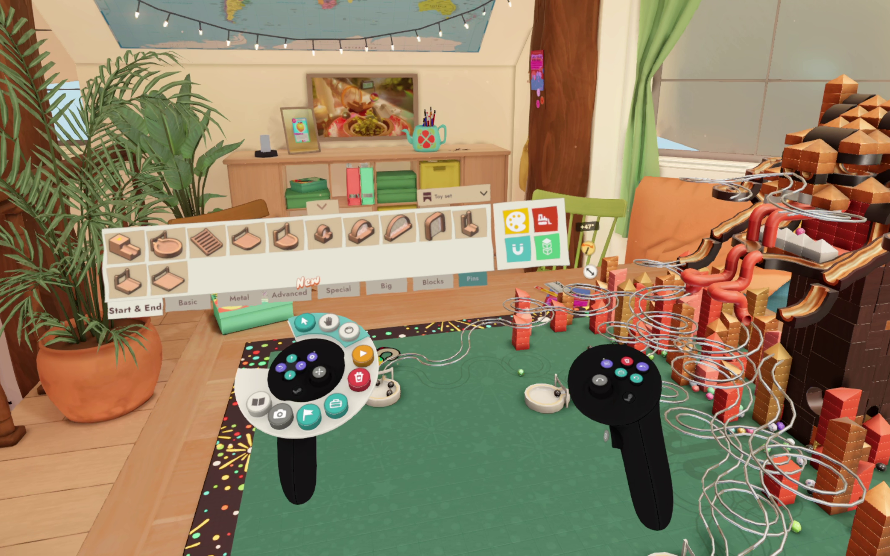
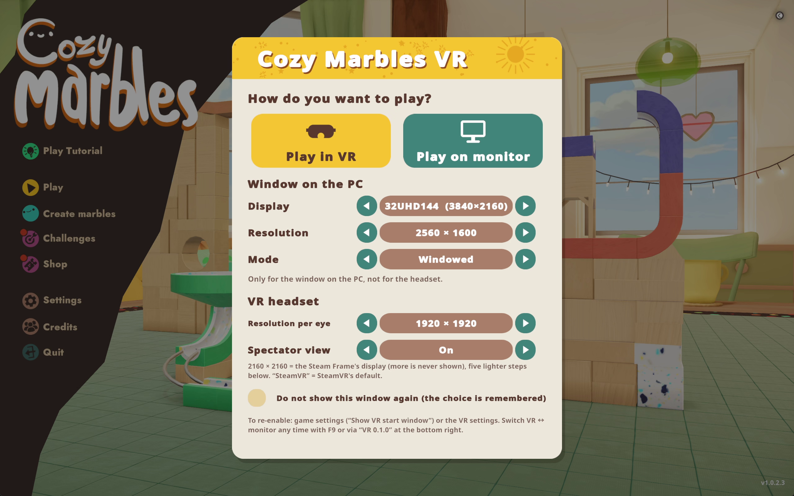
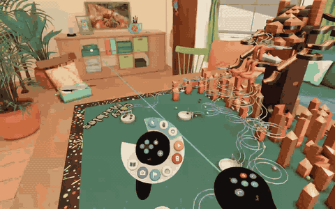
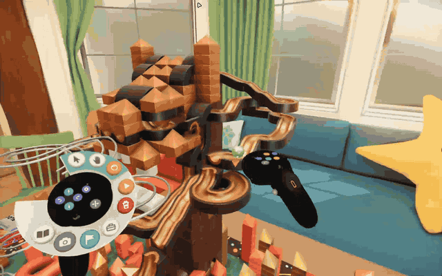
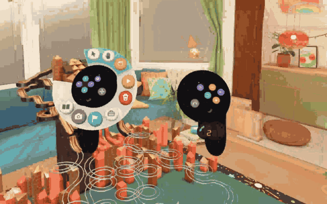

<p align="center">
  <picture>
    <source media="(prefers-color-scheme: dark)" srcset="docs/cozy_marbles_vr_dark.png">
    <source media="(prefers-color-scheme: light)" srcset="docs/cozy_marbles_vr_light.png">
    
  </picture>
</p>

<p align="center">
  <b>Build marble runs with your hands, in VR.</b><br>
  An unofficial VR mod for <a href="https://store.steampowered.com/app/2836460/">Cozy Marbles</a> with full motion-controller support.
</p>

<p align="center">
  <a href="https://github.com/TobseF/CozyMarbles-VR-Mod/releases/latest"></a>
  <a href="https://github.com/TobseF/CozyMarbles-VR-Mod/releases"></a>
  
  
  <a href="LICENSE"></a>
</p>

<p align="center">
  <a href="#installation">Installation</a> ·
  <a href="#features">Features</a> ·
  <a href="#controls">Controls</a> ·
  <a href="#settings">Settings</a> ·
  <a href="#uninstall">Uninstall</a> ·
  <a href="#building">Building</a>
</p>

<p align="center">
  
  
</p>

<p align="center">
  
  
  
</p>

The marble run sits in front of you as a tabletop model that you can grab, turn and scale. The menus float as
panels in the room, and you build with a laser pointer or directly with your hands. The mod was made for PC
streaming to the **Steam Frame**, but it works with any SteamVR / OpenXR headset. It doesn't change any game
files, and you can switch between VR and monitor at any time.

---

<a name="installation"></a>

## 📦 Installation

**You need:** Cozy Marbles on Steam (Windows), SteamVR and a PC VR headset.

1. Download **`CozyMarblesVR-with-BepInEx.zip`** from the [latest release](https://github.com/TobseF/CozyMarbles-VR-Mod/releases/latest).
2. Open the game folder: in Steam, right-click **Cozy Marbles** → **Manage** → **Browse local files**.
3. **Extract the zip into that folder**, so that `winhttp.dll` and the `BepInEx` folder end up next to
   `Cozy Marbles.exe`. Confirm overwriting if Windows asks.
4. Start **SteamVR**. Then start **Cozy Marbles from Steam on your PC** and click **Play in VR** in the start window.

That's it. The first start takes a few seconds longer while BepInEx sets itself up.

> [!TIP]
> **Already using BepInEx 5** (Mono, x64) for other Cozy Marbles mods? Download **`CozyMarblesVR.zip`** instead.
> It contains only the mod and is extracted the same way.

> [!IMPORTANT]
> Start the game **on your PC**, not from the library inside the headset. Steam doesn't know that the game can
> run in VR through a mod, so it would open the game on the virtual cinema screen, which doesn't show the VR image.

<details>
<summary>What the zip puts into the game folder</summary>

```
Cozy Marbles/
├─ winhttp.dll, doorstop_config.ini, .doorstop_version   ← BepInEx loader (full package only)
├─ BepInEx/
│  ├─ core/                                               ← BepInEx 5 (full package only)
│  ├─ patchers/CozyMarblesVR.Patcher.dll
│  └─ plugins/CozyMarblesVR/                              ← the mod, Unity XR assemblies, docs
└─ Cozy Marbles_Data/
   ├─ Plugins/x86_64/UnityOpenXR.dll, openxr_loader.dll   ← Unity's OpenXR runtime parts
   └─ UnitySubsystems/UnityOpenXR/UnitySubsystemsManifest.json
```

If a game update removes the files in `Cozy Marbles_Data`, the mod restores them from
`BepInEx/plugins/CozyMarblesVR/native`. Restart the game once in that case.

</details>

### Starting the game

- If SteamVR is running, the game starts in VR and waits until SteamVR shows it in the headset, so you can put the
  headset on or connect it later. The view is centered automatically when you put the headset on.
- If SteamVR wasn't running at launch, the mod keeps looking for it for ten minutes and then switches to VR by itself.
- Without a headset the game simply runs on the monitor.
- In the **start window** you choose the display, resolution and window mode. Check *Do not show this window again*
  to remember your choice. The switch **Show VR start window** in the game's settings (or in the VR settings) brings it back.

---

<a name="features"></a>

## ✨ Features

|                                |                                                                                                                                                                                                                                               |
| ------------------------------ | --------------------------------------------------------------------------------------------------------------------------------------------------------------------------------------------------------------------------------------------- |
| 🎲 **Tabletop marble run**     | The whole run as a model on a table in front of you. Grab the world with the grips to move, turn and scale it.                                                                                                                                |
| ✋ **Grab mode**                | Grab pieces with the controller and move them freely in space. A transparent ghost shows where they will snap.                                                                                                                                |
| 🔦 **Pointer mode**            | The game's original grid building, operated with a laser pointer.                                                                                                                                                                             |
| 🪟 **Menus in the room**       | The main menu floats in front of you. The build menu floats above your left controller, all toolbar functions sit as round buttons on it. Object options appear right above the selected piece.                                              |
| 🎮 **Steam Frame controllers** | Native input profile and the real 3D controller models, loaded from your SteamVR installation.                                                                                                                                                |
| 🖥️ **VR ↔ monitor**           | Switch any time with **F9**, the **Play in VR / Play on monitor** entry in the main menu, or the small **VR 0.1.0** label below the game's version number (hover = tooltip, click = confirmation). The PC window shows a calm spectator view. |
| 🌍 **English & German**        | All mod texts follow the game language (German → German, anything else → English).                                                                                                                                                            |

### Tools: pointer, hand, marble

**L2** (left trigger) switches the tool: pointer → hand → marble → pointer. The round buttons on the left controller
do the same; the active tool is lit, and the label on **R2** always shows what the trigger does.

- **Pointer:** the game's original building on the grid, with the laser as your mouse pointer.
- **Hand:** a small ball replaces the laser at the tip of the controller. Touch a piece (the ball turns yellow) and
  **hold R2**: the piece hangs on your hand and follows it freely, without the grid. Twist the controller to turn it
  in 90° steps. The height follows your hand. **Release** to set it down where the transparent preview shows.
  New pieces from the build menu hang on your hand in the same way and are placed with a trigger press.
  Decorations are not bound to the grid: with the **magnet** off they land exactly on the surface below the ball.
- **Marble:** the next marble waits at the tip of the controller; every **R2** press lets it go and the next one
  appears. **Y** (upper) throws faster, **A** (lower) slower – levels 0 to 6, at 0 the marble just drops. A small orange cone in front
  of the marble shows the direction (straight down when dropping); the level shows on a little LED ring with a
  7-segment display on the right handle. With **marble physics** on (VR settings, Marbles section) the waiting marble
  is solid and pushes other marbles; off, it is a see-through preview. Marbles that leave the play area are removed by
  the game after 15 seconds.

Pointing at a menu, the trigger always clicks the menu, whatever the tool.

### The controllers

- **Labels on the buttons:** every button carries a small coloured icon of what it does right now – it changes with
  the tool, in menus and on the second layer, and sinks in while pressed. Colours: teal = building, red = deleting,
  amber = marbles, purple = menus, grey = moving.
- **Round buttons on the left controller:** a collar around the left controller holds push buttons for everything
  the game's toolbar used to do: the three tools (on a common base – only one is active), **prepare marbles**,
  **delete all marbles**, **build menu** on/off, **racing**, **reset camera** and the **VR controls help**. While
  something is selected an **object options** button appears (shows / hides the options above the selection). Click
  them with the laser or touch them with the ball; in hand mode the laser appears as soon as you point at one.
- **Build menu:** fixed to the tip of the left controller like a tablet in your hand – it moves and turns with the
  controller and continues its button side (`AttachedTiltTowardsYou`). **X** (or its ring button) shows and hides
  it; closing it with its own arrow hides it too. Two handles at its lower right corner adjust it while you hold
  the trigger on them: the **resize** handle (diagonal arrows) follows the laser, from small to large (12–60 %); the
  **tilt** handle (curved arrow) turns the menu like your pointing hand – tip the hand back and the menu leans back by
  the same angle. 0° is flush with the controller's button ring, up to +75° towards you and −75° away from you; within
  ±5° it snaps softly to 0. Size or angle is shown next to the handles while you hold them; the laser is hidden while
  you tilt.

### Windows in VR

- **Main menu** (also pause and dialogs): only the menu itself (plus an open dialog), centred in front of you.
  All menus are real objects in the room with a proper depth for both eyes – so they are never painted over a piece
  that is actually closer to you. If scenery stands between you and an open menu (the marble run in the main
  menu's room), you step back and up a little while the menu is open, and the menu moves closer if that is not
  enough; when it closes you are back where you were. At every start you stand at the start position and the main menu is in front
  of you, wherever you are in your room. In menus, **L2** brings the menu back in front of you and **R2** pointed
  into empty space puts you back at the start position.
- **VR settings:** **View button** on the left controller, or "VR settings" in the main menu. In menus they take the
  main menu's place (closing them brings it back); at the top they switch over to the game's own settings.
- **Object menu:** select a piece and its options (move, color, delete, settings) appear right above it, turned
  towards you.
- **Labels on objects** (marble names, starter and checkpoint info, portal links, selection box) sit at the depth
  of their object, right in front of it, and you can press their buttons with the laser.
- Free-standing windows have a small bar underneath: grab the **bar** to move it (right stick = further/closer) and
  drag the round **resize** button at the corner to resize it. Everything is saved.

---

<a name="controls"></a>

## 🎮 Controls

Default layout for the Steam Frame controllers (native binding), with the laser on the right hand. You can switch
the hand with `PointerHand`, or remap everything in SteamVR's *Controller Bindings*.

| Controller | Input | Action | Second layer (hold L-stick click) |
| ---------- | ----- | ------ | --------------------------------- |
| Right | R2 (trigger) | Click: place, select, drag, use menus · hand: grab / release · marble: drop / throw · menus, pointed into empty space: back to the start position | |
| Right | A | Rotate piece · in menus: select · marble: throw slower | Copy |
| Right | B | Cancel (right click) · in menus: back | Paste |
| Right | X | Build menu on / off | Cut |
| Right | Y | Delete · marble: throw faster | Magic draw vertical |
| Right | Menu button | Main menu / pause | |
| Right | R1 (bumper) | Roll the marbles | |
| Right | Stick left/right | Turn (30° snap turn) | |
| Right | Stick up/down | While placing: build height · on panels: scroll · otherwise: fly up/down | |
| Right | Stick click | Magnet snapping on/off | Recenter view |
| Right | Grip | Grab and move the world | |
| Left | L2 (trigger) | Next tool: pointer → hand → marble · in menus: menu back in front of you | |
| Left | L1 (bumper) | Shift: free height / multi-select | |
| Left | Grip | Grab and move the world · both grips: scale and rotate it (the scale is saved) | |
| Left | D-pad | Height up/down, undo (left), redo (right) · in menus: move focus | |
| Left | Stick | Fly (in view direction) · in menus: move focus | |
| Left | Stick click | Hold: second layer | |
| Left | View button | VR settings | |

**Menus without the laser:** in the main menu, pause screen and dialogs, the left D-pad or stick moves a focus
cursor, **A** clicks and **B** presses the dialog's back button. As soon as you move the laser or pull the trigger,
the laser takes over again.

**Keyboard:** **F9** switches between VR and monitor, **F10** hides / shows the info banner of the spectator view (e.g. for screen recordings), **F11** switches the
spectator view off and on. Off, the PC window shows a small screen with buttons (spectator view on, play on the
monitor, quit) instead of a third picture of the world – that saves graphics power. The VR settings ("PC screen")
also set the spectator resolution (25–100 % of the window) independently of the headset. The launch option `-novr` starts on the monitor without the
start window.

**Resolutions – which one does what:**

- **Headset:** VR settings → "Headset picture" → **Resolution per eye**, also in the start window. Choose the
  Steam Frame's own display (**2160 × 2160** – more is never shown) or one of five lighter steps (1920, 1728, 1536,
  1344, 1152; the height follows SteamVR's aspect ratio), or **SteamVR** to use what SteamVR asks for (its per-app
  resolution, read when the game starts). Changes apply at once; the line below shows what is really rendered.
  The start window warns in red when SteamVR asks for far more than the Steam Frame shows.
- **FPS readout:** VR settings → "FPS readout": frame rate against the headset's refresh rate (green / yellow / red),
  frame time and pixels per eye, just below your view.
- **PC window:** the resolution in the game's own settings (and in the start window) only sizes the window on
  the monitor; it has no effect on the headset.
- **Spectator view:** VR settings → "PC screen" → spectator resolution (25–100 % of the window).

---

<a name="settings"></a>

## ⚙️ Settings

Most settings can be changed in VR (the **VR** button). Everything is stored in
`BepInEx\config\tobse.cozymarbles.vr.cfg`, which is created on the first start:

| Setting                                                         | Meaning                                                                                                                             |
| --------------------------------------------------------------- | ----------------------------------------------------------------------------------------------------------------------------------- |
| `WorldScale`                                                    | Scale of the model (8 = table model about 2 m wide, 1 = life size)                                                                  |
| `Enabled`                                                       | `false` turns VR off without uninstalling (same as the launch option `-novr`)                                                       |
| `DesktopView`                                                   | Spectator view in the PC window while in VR                                                                                         |
| `DesktopViewScale`, `DesktopHint` | Spectator resolution relative to the window (0.25–1), info banner on/off |
| `ShowControllerModels`                                          | Steam Frame controller models (otherwise simple boxes)                                                                              |
| `EyeResolution`, `ShowFps`, `PostProcessing`, `DepthOfField`    | Headset pixels per eye (0 = SteamVR, 2160 = Steam Frame), FPS readout, image quality vs. performance                                |
| `[Controls] PointerHand, Turning, SnapTurnDegrees, MoveSpeed …` | Laser hand, snap/smooth turning, movement                                                                                           |
| `[Controls] MenuNavigation`, `SteamFrameControllerProfile`      | D-pad menu navigation, native Frame profile (off = SteamVR's Touch emulation)                                                       |
| `[Grab] GrabMode, MarbleMode, ThrowLevel, MarblePhysics, Reach, HoldSeconds, ToggleBumper, ShowGhost`  | Grab mode on/off, reach of the ball, hold time before grabbing, double-tap bumper (`Left`/`Right`/`Both`/`None`), placement preview |

---

<a name="uninstall"></a>

## 🗑️ Uninstall

Delete from the game folder: `BepInEx\plugins\CozyMarblesVR`, `BepInEx\patchers\CozyMarblesVR.Patcher.dll` and
optionally `Cozy Marbles_Data\Plugins\x86_64\UnityOpenXR.dll`, `openxr_loader.dll` and
`Cozy Marbles_Data\UnitySubsystems`.
To remove BepInEx as well, also delete `winhttp.dll`, `doorstop_config.ini`, `.doorstop_version` and the
`BepInEx` folder. *Verify integrity of game files* in Steam restores anything the game itself needs.

---

## ⚠️ Known limitations

- Development and testing happened mainly against Unity's mock OpenXR runtime. Feedback from real headsets is very welcome.
- Stereo rendering runs in multi-pass mode (the game has no single-pass shaders), which costs performance.
- The game's tutorial texts still mention mouse and keyboard buttons.
- A few hint arrows that the game aligns to objects in the room appear on the menu panel.

---

<a name="building"></a>

## 🛠️ Building from source

<details>
<summary>Requirements, build and release</summary>

**Requirements:** Windows, Cozy Marbles, [BepInEx 5](https://github.com/BepInEx/BepInEx/releases) (x64, Mono)
installed in the game folder, and Visual Studio 2022 or the Build Tools (Roslyn `csc`).

Clone the repository **into the game folder as `CozyMarblesVR`**. The mock runtime for testing is looked up there. If
you build from somewhere else, set `COZY_MARBLES_DIR` to the game folder.

```powershell
cd "…\steamapps\common\Cozy Marbles"
git clone https://github.com/TobseF/CozyMarbles-VR-Mod.git CozyMarblesVR
cd CozyMarblesVR
.\build\build.ps1        # compile and install into the game
.\build\make-dist.ps1    # build + collect the release zips in .\dist
```

`make-dist.ps1` creates `dist\CozyMarblesVR.zip` (mod only) and `dist\CozyMarblesVR-with-BepInEx.zip`.
Both mirror the game folder. Upload both as assets of a release tagged with the version from `src/Plugin/Plugin.cs`
(e.g. `0.1.0`). The asset names stay the same in every release, so
`https://github.com/TobseF/CozyMarbles-VR-Mod/releases/latest/download/CozyMarblesVR-with-BepInEx.zip` always points to
the newest version, which helps installer hubs and scripts.

| Path          | Content                                                                                                                                                                        |
| ------------- | ------------------------------------------------------------------------------------------------------------------------------------------------------------------------------ |
| `src/Shim`    | Replacements for `UnityEngine.Input` and the camera projections                                                                                                                |
| `src/Patcher` | BepInEx preloader patcher that redirects the game's calls to the shim (in memory)                                                                                              |
| `src/Plugin`  | OpenXR start-up, rig and cameras, panels, input, locomotion, grab mode                                                                                                         |
| `lib`         | XR assemblies compiled from Unity's packages (OpenXR 1.16.1, XR Management 4.5.4, XR Core Utils 2.5.3) and the native OpenXR libraries. Rebuild with `build\build-xr-deps.ps1` |

After a game update, running `build\build.ps1` again is usually enough.

### Testing without a headset

Set `[Debug] MockRuntime = true`, `SimulateControllers = true` and `Diagnostics = true` in the config. The mod
then runs against Unity's mock OpenXR runtime (`lib/mock`). Commands written to `BepInEx\cozyvr-cmd.txt` drive
simulated controllers and save screenshots to `BepInEx\cozyvr-out` (see `src/Plugin/Diagnostics.cs` for the command
list).

</details>

---

<sub>Cozy Marbles VR is a fan project and is not affiliated with the developers of Cozy Marbles, Valve or Unity.
The mod's own code is released under the [MIT license](LICENSE). Third-party components keep their own licenses,
listed in [THIRD-PARTY-NOTICES.md](THIRD-PARTY-NOTICES.md).</sub>


